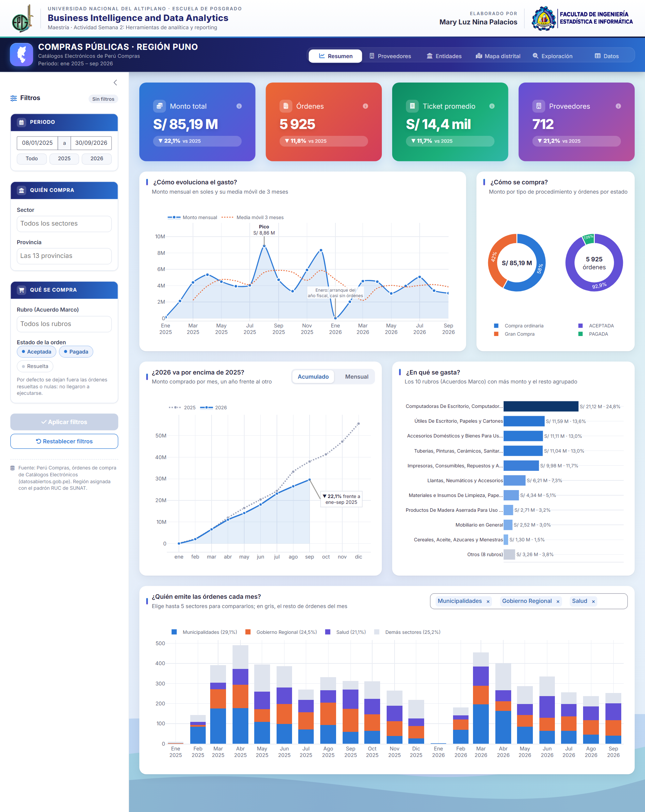
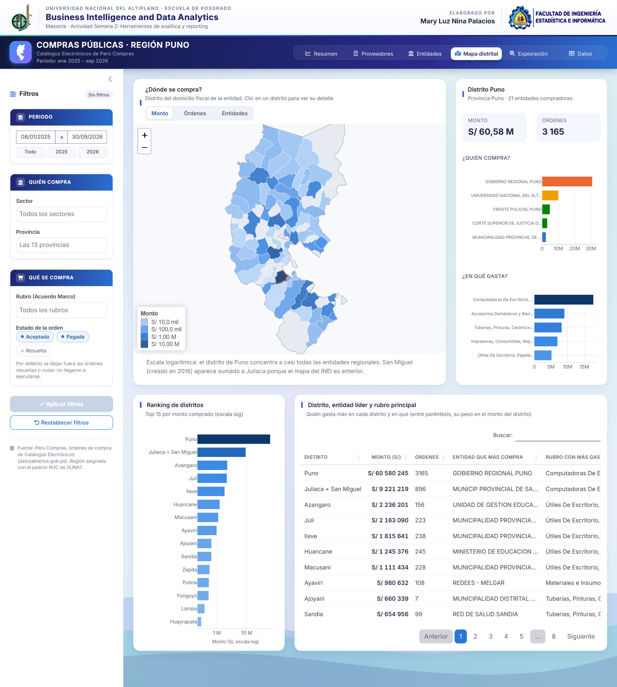

# Compras públicas · Región Puno

Módulo de análisis exploratorio de datos (EDA) y *reporting* desarrollado en **R Shiny** sobre las órdenes de compra que las entidades públicas de la región Puno emitieron mediante los Catálogos Electrónicos de Perú Compras, entre enero de 2025 y septiembre de 2026.

**Universidad Nacional del Altiplano · Escuela de Posgrado**
Maestría · Curso *Business Intelligence and Data Analytics*
Actividad Semana 2: Herramientas de analítica y *reporting*

**Elaborado por:** Mary Luz Nina Palacios

🔗 **Aplicación en línea:** https://mlnp.shinyapps.io/compras-puno/

📄 **Informe comparativo Shiny frente a Power BI:** [PDF](https://github.com/mlnp-dev/compras-puno-powerbi/blob/main/informe/Semana%202%20-%20Informe%20Mary%20Luz%20Nina%20Palacios.pdf)

🔗 **Versión en Power BI del mismo análisis:** https://github.com/mlnp-dev/compras-puno-powerbi · [reporte en línea](https://app.powerbi.com/view?r=eyJrIjoiMmJlMGJlMjQtZmU5My00YzU3LWEwZGYtMjdlNGJiZDMzNDMwIiwidCI6ImM0YTY2YzM0LTJiYjctNDUxZi04YmUxLWIyYzI2YTQzMDE1OCIsImMiOjR9)



## Contenido de la aplicación

| Pestaña | Qué muestra |
|---|---|
| **Resumen** | Indicadores clave (monto, órdenes, ticket promedio, proveedores) con su variación frente a 2025, evolución mensual del gasto, comparación 2026 vs. 2025 y principales rubros. |
| **Proveedores** | Concentración del gasto en las empresas proveedoras. |
| **Entidades** | Entidades compradoras y su distribución por sector y provincia. |
| **Mapa distrital** | Mapa de los distritos de Puno; al hacer clic se ve quién compra y en qué se gasta. |
| **Exploración** | Distribuciones, relaciones y patrones temporales de las órdenes. |
| **Datos** | Tabla de órdenes filtradas con descarga en CSV. |

Los filtros laterales (periodo, sector, provincia, rubro y estado de la orden) se aplican con el botón **Aplicar filtros**.



## Datos

- **Fuente:** Perú Compras, *Órdenes de compra realizadas a través de los Catálogos Electrónicos*, Plataforma Nacional de Datos Abiertos (datosabiertos.gob.pe).
- **Filtro regional:** entidades con domicilio fiscal en el departamento de Puno (ubigeo 21, padrón RUC de SUNAT).
- **Resultado:** `data/compras_puno_2025_2026.csv`, con 5 929 órdenes. Por defecto la aplicación analiza las 5 925 aceptadas o pagadas (S/ 85,19 millones con IGV).
- **Límites distritales:** INEI, en `data/ref/geo/puno_distritos.geojson`.

## Ejecución local

Requiere R (≥ 4.3) y los paquetes:

```r
install.packages(c("shiny", "bslib", "dplyr", "tidyr", "readr", "plotly",
                   "DT", "scales", "sf", "leaflet"))
```

Luego, desde esta carpeta:

```r
shiny::runApp()
```

## Estructura

```
app.R            Interfaz y lógica de la aplicación
data/            Órdenes de compra de Puno y límites distritales
www/             Logos institucionales
capturas/        Imágenes de referencia de la aplicación
```
